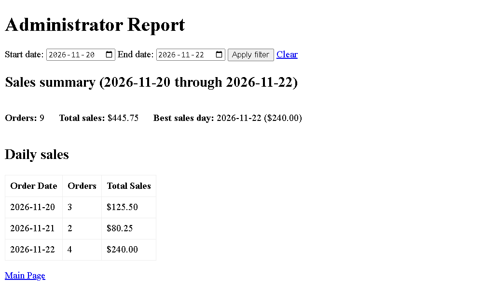

# COSC 304 Lab 9 - AI-Assisted Feature Report

## Feature Plan

I added a date filter to the administrator sales report. It lets the administrator choose a start date and end date to see only orders from that period. I chose this feature because it is useful and easy to add to the existing report. The steps were to add a form, validate the dates, filter the database results, and show the totals.

## How AI Was Used

I used GitHub Copilot in VS Code to help write the date filter and tests. I asked it how to validate dates and use parameters with the SQL query. I tested the AI's suggestions by running four small tests. The tests checked valid dates, an incorrect date range, and the report page. I also checked the report in a browser.

## Reflection

AI helped save time by suggesting code and test ideas. It worked well for writing the basic Flask and HTML code. I still needed to check the code and run tests to make sure it worked. In the future, I would give the AI small tasks and test each result before continuing.

## How It Works

The administrator opens `/admin` and enters a start date and end date. The report validates the dates and uses them to filter the SQL results. It then shows the number of orders, total sales, best sales day, and daily sales table.

